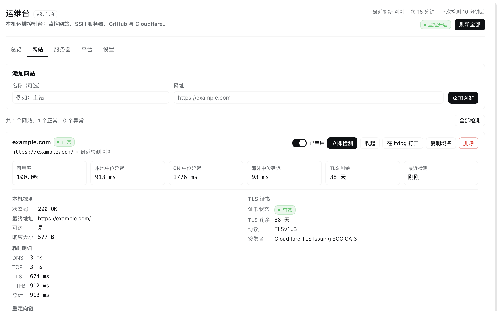

# Ops console · dsh-ops-console

[中文](README.md) | English

[](https://github.com/lioez/dsh-ops-console/actions/workflows/test.yml)
[](LICENSE)

A local DeepSeek Harness plugin that adds an **Ops console** entry to the left
sidebar. It shows GitHub, Cloudflare and SSH server status, and checks deployed
websites from this Mac plus mainland-China and overseas Globalping probes.



The screenshot uses `example.com`; real configuration stays on your machine.

## Features

- Overview: site health, CN/global median latency, server availability, GitHub
  and Cloudflare connection state.
- Websites: add/remove sites, manual or scheduled checks, local + CN + overseas
  results, TLS expiry, per-node latency, redirects, uptime history.
- Servers: read-only SSH status — hostname, OS, uptime, load, memory, disk,
  failed systemd units and Docker container count.
- Platforms: GitHub login and watched-repository Actions/PR summaries; Cloudflare
  account, Pages projects and recent deployments.
- Settings: monitor interval, CN probe count, overseas countries, Globalping
  quota, data directory and cache controls.

## Install

Requires DeepSeek Harness `>= 0.2.2-rc.3`. This is a local plugin; it is not
published to npm.

```bash
git clone https://github.com/lioez/dsh-ops-console.git
```

Then use **Plugins → Add plugin** in DSH, or install with:

```text
plugin_manager install_bundle → target: /absolute/path/to/dsh-ops-console
```

Refresh the Web GUI after installation. The entry appears in the left sidebar as
**运维台** (Ops console).

## Prerequisites

- **GitHub**: `gh` installed and signed in (`gh auth login`).
- **Cloudflare**: `wrangler` installed and signed in (`wrangler login`), with
  access to your Pages projects. v1 covers Pages only; use the dashboard for
  Zones/DNS/Workers.
- **SSH**: key-based or ssh-agent login must work non-interactively. The plugin
  does not collect passwords, does not read `~/.ssh/config`, and does not weaken
  host-key verification.
- **Website checks**: no API key. Globalping's anonymous quota applies; when it
  is exhausted, the local probe still runs.

## Privacy

Configuration and history live in `$DSH_HOME/ops-console/` (mode `0700`,
files `0600`). No GitHub/Cloudflare token, SSH password or private key is stored.
Commands reuse the existing CLI/SSH setup. Query strings and fragments are
removed from monitored URLs before sending a target to Globalping. Remote writes
(restart, deploy, purge cache, re-run workflow) are not implemented in v1.

## Data sources

- Local: Node `http`/`https`, recording DNS, TCP, TLS, first byte and total time.
- Multi-region: [Globalping](https://globalping.io/docs/api.globalping.io).
- Manual: [itdog](https://www.itdog.cn/http/) deep link. itdog has no public API;
  the plugin does not scrape it or embed it in an iframe.

## Test

```bash
node --test test/
node --check client.js
```

CI runs the same suite on Node 22 and 24.

## Limitations

- Monitoring only runs while DSH is open; it is not a 24/7 external probe.
- Read-only: no remote restart, deployment, cache purge or workflow re-run.
- Cloudflare: Pages only.
- SSH metrics target Linux; macOS targets return partial `/proc` metrics.
- Globalping node count and quota are controlled by a third party.
- The itdog link is a manual convenience, not an automated data source.

See [SECURITY.md](SECURITY.md) for the security model and private reporting.

## License

MIT © 2026 [Lioez](https://github.com/lioez)
