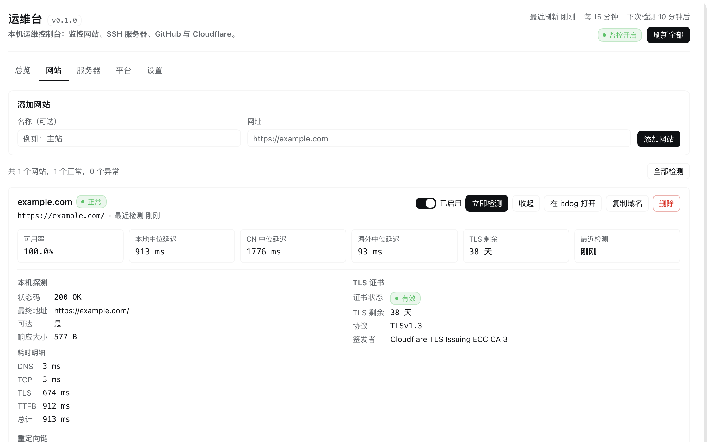

# 运维台 · dsh-ops-console

[中文](README.md) | [English](README.en.md)

[](https://github.com/lioez/dsh-ops-console/actions/workflows/test.yml)
[](LICENSE)


一个本地 DeepSeek Harness 插件：在左侧栏增加「运维台」，集中查看 GitHub、Cloudflare、SSH 服务器和你部署的网站。网站检测会同时从这台 Mac（本机/国内基线）和 Globalping 的中国大陆 / 海外节点发起，给出连通性、HTTP 状态、延迟分解、TLS 证书和逐节点明细。



> 截图中的站点为 `example.com`；真实配置保存在本机，不会进入仓库。

## 它做什么

| 区域 | 内容 |
| --- | --- |
| 总览 | 站点在线/异常、国内/海外中位延迟、服务器在线数、GitHub/Cloudflare 连接状态 |
| 网站 | 添加/删除站点，手动或定时检测；本机 + 国内 + 海外三组结果；TLS 到期天数；历史与可用率 |
| 服务器 | 添加 SSH 目标，读取 hostname / OS / uptime / load / 内存 / 磁盘 / failed units / Docker 容器数 |
| 平台 | GitHub 账号与监听仓库的最近 Actions、PR 数；Cloudflare 账号、Pages 项目与最近部署 |
| 设置 | 监控间隔、国内探测节点数、海外国家、Globalping 额度、数据目录、清空历史 |

## 安装

需要 DeepSeek Harness `>= 0.2.2-rc.3`。这是本地插件，不通过 npm 发布。

```bash
git clone https://github.com/lioez/dsh-ops-console.git
```

然后在 DSH 里用 **Plugins → Add plugin** 选择该目录，或由插件管理器安装：

```text
plugin_manager install_bundle → target: /absolute/path/to/dsh-ops-console
```

安装后刷新 Web GUI，左栏出现「运维台」。Host 半的改动需要重启/重载插件；只改 `client.js` 且本机运行着 `pnpm run dev:web` 时才会自动热更新。

## 前置条件

- **GitHub**：`gh` 已安装并登录（`gh auth login`），账号至少能读取你要监听的仓库。
- **Cloudflare**：`wrangler` 已安装并登录（`wrangler login`），账号有 Pages 读取权限。v1 只展示 Pages 项目/部署；Zones、DNS、Workers 请走 Dashboard。
- **SSH**：本机有 `ssh`，目标主机可用密钥或 ssh-agent **非交互**登录。插件不收集密码，不会自动接受未知 host key；第一次连接请在终端完成并确认指纹。
- **网站检测**：无需 API key。Globalping 允许匿名使用，但有每小时额度；额度不足时本轮只做本机检测，并在界面里标明。

## 使用

1. 打开「运维台」→「网站」→ 添加站点 URL。添加后会自动检测一次。
2. 「全部检测」立即跑所有站点；定时任务默认每 15 分钟一次，只在 DSH 进程运行时有效。
3. 站点展开可见本机 DNS/TCP/TLS/首字节/总耗时、重定向链、TLS 信息、国内外逐节点结果。
4. 「在 itdog 打开」会用当前域名打开 itdog 现有的全国测速页（`auto_submit=1`），用于手动复核；插件不抓取 itdog。
5. 「服务器」添加 ssh 别名/域名/IP 后会自动跑一次只读状态命令；「平台」添加 GitHub 仓库或从已发现的 Pages 项目中选择。

## 状态含义

- **正常**：本机 2xx/3xx，国内/海外节点没有失败，TLS 有效。
- **降级**：网站仍可访问，但部分探测节点失败、TLS 无效/即将到期，或本机返回 401/403（可能被 WAF/鉴权拦截）。
- **异常**：本机不可达，或返回 4xx/5xx 等非预期状态。
- **未知**：还没有完成检测，或上一次检测被取消。

站点页的「状态说明」和状态标签的提示里也有同一份定义；被取消的检测不会覆盖上一次结果。

## SSH 密钥与主机指纹

- **私钥路径留空时**：`ssh` 自己会读取 `~/.ssh/config`、默认密钥（`~/.ssh/id_*`）和 ssh-agent。插件不读取这些文件，也不保存密码。
- **macOS**：添加服务器时可点「选择文件…」打开系统文件选择器；其他平台请手动填写路径。
- 查看本机配置：`ls -la ~/.ssh`、`ssh-add -l`、`ssh -G <目标别名>`。
- 把密钥加入 agent：`ssh-add ~/.ssh/id_ed25519`（macOS 可用 `ssh-add --apple-use-keychain`）。
- 主机密钥未验证时，服务器详情会给出可复制的 `ssh ...` 命令；在终端运行一次、确认指纹后重试。插件不会自动关闭 host-key 校验。

## 数据与隐私

- 所有配置和历史都在 `$DSH_HOME/ops-console/`（默认 `~/.dsh/ops-console/`），目录 `0700`、文件 `0600`。
- **不保存** GitHub / Cloudflare Token、SSH 密码或私钥内容；复用本机已有 CLI/SSH 凭据。
- 插件不读取 `~/.ssh/config` 或 `~/.ssh` 下的私钥；这些由 `ssh` 自己解析。
- 站点 URL 的 query/fragment 会被移除；Globalping 只收到 hostname 和路径，不会收到 query 中的令牌。
- SSH 命令固定为只读状态采集，不执行用户输入；`execFile` 参数数组，不经 shell。
- 远端写操作（重启、部署、清缓存、rerun workflow）不在 v1 中。

## 数据源

- 本机探测：Node `http`/`https`，记录 DNS、TCP、TLS、首字节（含连接）和总耗时。
- 多地域探测：[Globalping](https://globalping.io/docs/api.globalping.io) 公共 API。验证时中国有 34 个节点、全球 5506 个；匿名额度 250 次/小时，**按本机公网出口 IP 计量，不绑定账号**，同一 IP 的其他使用会共用。
- 手动复核：[itdog](https://www.itdog.cn/http/)。itdog 没有公开 API，页面依赖前端 JS/WebSocket 与 Cookie 反爬；插件不抓取、不 iframe，只提供预填深链。

## 架构

```text
dsh-ops-console/
├─ index.js                  Host 入口：状态、监控、路由注册
├─ client.js                 浏览器半：sidebar.panellist + main 页面
├─ src/
│  ├─ state.js               插件自有 JSON 持久化（原子写）
│  ├─ validation.js          输入/配置校验
│  ├─ snapshot.js            UI 快照组装 + 站点状态判定
│  ├─ monitor.js             调度、探测与 provider 编排
│  ├─ routes.js              两条 /api/ops-console 路由（连接内核认证）
│  ├─ cli.js                 gh/wrangler/ssh 子进程边界
│  ├─ probes/local-http.js   本机 HTTP/TLS 探测
│  ├─ probes/globalping.js   Globalping 客户端
│  └─ providers/             ssh / github / cloudflare
├─ docs/screenshot.png       界面截图
└─ test/                     node:test 单元测试
```

Host 不引入任何 DSH 内部包，只用 Node 内置模块；Client 只使用 shell 提供的 `react`。两条路由：

- `GET /api/ops-console/snapshot`
- `POST /api/ops-console/action`

路由通过 `ctx.connection.fetch.register` 注册，认证由 DSH 内核完成。

## 测试

```bash
node --test test/*.test.js
node --check client.js
```

单元测试覆盖状态、校验、本机探测、Globalping、SSH、GitHub/Cloudflare 解析、快照、动作路由和原生选择器。CI 在 Node 22 / 24 上跑同一套测试。

发布前还可以运行：

```text
publish_plugin check
```

## 已知限制

- 只在 DSH 运行时监控，不是 7×24 外部探针。
- 不执行远端写操作。
- Cloudflare 只覆盖 Pages；Zones/DNS/Workers 未接入。
- SSH 目标以 Linux 为主；macOS 能连通但部分 `/proc` 指标为空。
- Globalping 节点和额度由第三方决定；CN 节点以机房/家宽混合社区节点为准。
- 界面中英文文案已一并提供；插件详情页使用本 README 回退，未制作功能图。

## 安全

见 [SECURITY.md](SECURITY.md)。漏洞请通过 GitHub 的 **Security → Advisories** 私下报告。

## License

MIT © 2026 [Lioez](https://github.com/lioez)
